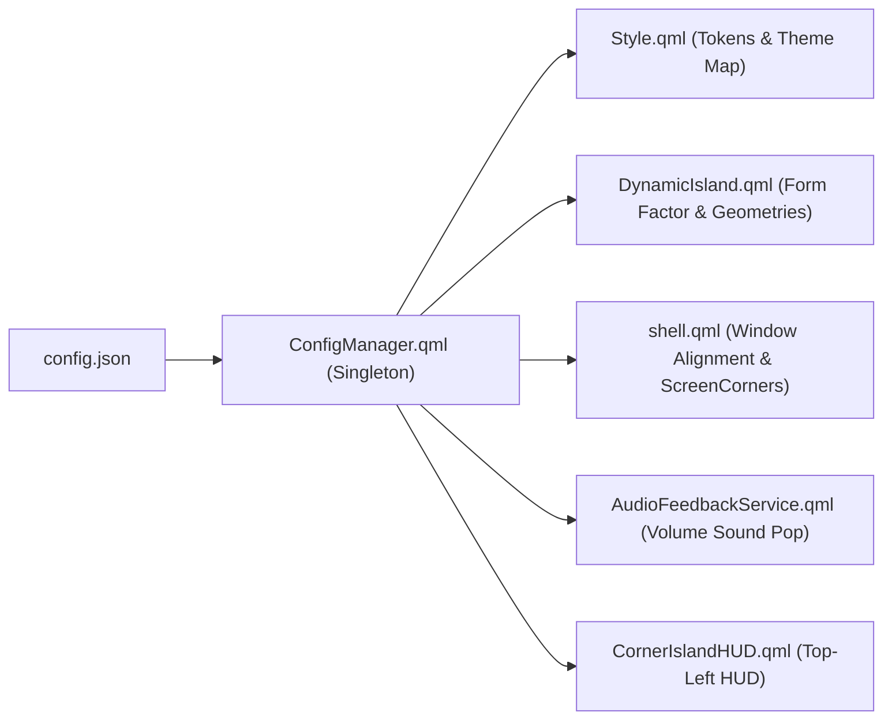

# Configuration System & JSON Schema Specification

> [!NOTE]
> `ogsShell-qs` configuration is centralized in `config.json`, allowing users and developers to switch between **Dynamic Island** and **Dynamic Notch** modes, configure geometry (idle/hover/transient/expanded height and width), choose themes, and adjust animation parameters without modifying QML code.

---

## 1. Configuration File Locations & Dual Reactive Synchronization

The configuration system continuously watches both locations using a real-time event-driven `inotifywait` process and fresh disk reader:
1. **User Custom Config (Canonical):** `$XDG_CONFIG_HOME/ogsShell/config.json` (or `~/.config/ogsShell/config.json`)
2. **Project Workspace Config:** `shell/config.json`

* **Synchronous Cold-Boot Preload & Race-Free Hot Reloading (<5ms):** `Config.qml` hydrates synchronously on startup from canonical `$XDG_CONFIG_HOME/ogsShell/config.json` via `FileView { preload: true }` (preventing cold-boot IPC messages like `theme_update` from ever clobbering disk config with defaults), watches ONLY atomic completion events (`close_write`, `moved_to`) via `inotifywait`, and polls `userConfigPath` as fallback.
* **Serialized Atomic Two-Way Sync (`os.replace`):** `Config.saveConfig()` writes immediately on leading edge and queues rapid slider drags sequentially without ever terminating an in-flight writer process. Each target (`shared/app_configs/shell/config.json`, `settings_app/config.json`, `shell/config.json`, and canonical `$XDG_CONFIG_HOME/ogsShell/config.json` last) is written via `<path>.tmp.<pid>` + `fsync` + `os.replace` and preserves all schema blocks including `corner_tray` and `lockscreen`.
* **Theme Synchronization & Cold-Boot Resilience:** To prevent cold-boot theme mismatches, `Config.theme` is bound to `Style.activeThemeId`. On startup, `Config.updateTheme(themeId)` never writes to disk until `initialLoadDone` is true.
* **Live UI Morphing:** Window spacers (`reservedSpacerWindow`), input masks (`activeInputEnvelope`), typography scale, color tokens (`Style.qml`), and Dynamic Notch vector Bézier paths instantly resize upon saving without requiring a manual shell restart.

---

## 2. Complete JSON Schema Specification

```json
{
  "$schema": "https://json-schema.org/draft/2020-12/schema",
  "title": "OgsShell Configuration",
  "type": "object",
  "properties": {
    "form_factor": {
      "type": "string",
      "enum": ["island", "notch"],
      "default": "island",
      "description": "Visual presentation format: floating island or top-bezel notch."
    },
    "theme": {
      "type": "string",
      "enum": ["catppuccin", "nord", "tokyonight", "everforest", "gruvbox", "monochrome"],
      "default": "catppuccin",
      "description": "Active color scheme palette from shared/themes/themes.json."
    },
    "typography": {
      "type": "object",
      "properties": {
        "font_display": { "type": "string", "default": "Noto Sans Display", "description": "Display & number font family (e.g. Noto Sans Display, Outfit, Plus Jakarta Sans)" },
        "font_weight_display": { "type": "string", "default": "SemiBold", "description": "Font weight for display typography: Thin, Light, Normal, Medium, SemiBold, Bold, ExtraBold, Black or 100-900" },
        "font_text": { "type": "string", "default": "Inter", "description": "Body & UI text font family (e.g. Inter)" },
        "clock_idle_size": { "type": "integer", "default": 16 },
        "clock_hover_size": { "type": "integer", "default": 20 },
        "date_hover_size": { "type": "integer", "default": 13 },
        "media_title_size": { "type": "integer", "default": 12 },
        "media_artist_size": { "type": "integer", "default": 11 },
        "connectivity_text_size": { "type": "integer", "default": 11 },
        "connectivity_icon_size": { "type": "integer", "default": 14 },
        "notification_title_size": { "type": "integer", "default": 13 },
        "notification_body_size": { "type": "integer", "default": 11 },
        "pinned_metrics_size": { "type": "integer", "default": 11 },
        "pinned_metrics_icon_size": { "type": "integer", "default": 13 }
      }
    },
    "island": {
      "type": "object",
      "properties": {
        "top_margin": { "type": "integer", "default": 8 },
        "idle_width": { "type": "integer", "default": 180 },
        "idle_height": { "type": "integer", "default": 36 },
        "hover_width": { "type": "integer", "default": 220 },
        "hover_height": { "type": "integer", "default": 42 },
        "transient_width": { "type": "integer", "default": 340 },
        "transient_height": { "type": "integer", "default": 56 },
        "expanded_width": { "type": "integer", "default": 320 },
        "expanded_height": { "type": "integer", "default": 140 },
        "radius_full": { "type": "integer", "default": 18 },
        "radius_expanded": { "type": "integer", "default": 24 }
      }
    },
    "notch": {
      "type": "object",
      "properties": {
        "top_margin": { "type": "integer", "default": 0 },
        "idle_width": { "type": "integer", "default": 190 },
        "idle_height": { "type": "integer", "default": 34 },
        "hover_width": { "type": "integer", "default": 230 },
        "hover_height": { "type": "integer", "default": 40 },
        "transient_width": { "type": "integer", "default": 350 },
        "transient_height": { "type": "integer", "default": 58 },
        "expanded_width": { "type": "integer", "default": 330 },
        "expanded_height": { "type": "integer", "default": 150 },
        "bottom_radius": { "type": "integer", "default": 20 },
        "bottom_radius_expanded": { "type": "integer", "default": 26 }
      }
    },
    "notifications": {
      "type": "object",
      "properties": {
        "enabled": { "type": "bool", "default": true },
        "default_timeout_ms": { "type": "integer", "default": 2200 }
      }
    },
    "animation": {
      "type": "object",
      "properties": {
        "duration_compact": { "type": "integer", "default": 280 },
        "duration_transient": { "type": "integer", "default": 320 },
        "duration_expanded": { "type": "integer", "default": 360 },
        "overshoot_factor": { "type": "number", "default": 1.08 }
      }
    },
    "screen_corners": {
      "type": "object",
      "properties": {
        "enabled": { "type": "bool", "default": true },
        "radius": { "type": "integer", "default": 14 },
        "color": { "type": "string", "default": "#000000" },
        "top_left": { "type": "bool", "default": true },
        "top_right": { "type": "bool", "default": true },
        "bottom_left": { "type": "bool", "default": true },
        "bottom_right": { "type": "bool", "default": true }
      }
    },
    "audio": {
      "type": "object",
      "properties": {
        "over_amplification": { "type": "bool", "default": false, "description": "Allows raising master/app volume up to max_volume (150%) across all shell sliders, HUD, and ogsshell.sh volume CLI" },
        "max_volume": { "type": "integer", "default": 150, "description": "Upper volume ceiling percentage (up to 150) when over_amplification is enabled" }
      }
    },
    "audio_feedback": {
      "type": "object",
      "properties": {
        "enabled": { "type": "bool", "default": true },
        "volume_change_sound": { "type": "bool", "default": true },
        "throttle_ms": { "type": "integer", "default": 100 },
        "custom_sound_path": { "type": "string", "default": "" }
      }
    },
    "corner_hud": {
      "type": "object",
      "properties": {
        "enabled": { "type": "bool", "default": true },
        "volume_enabled": { "type": "bool", "default": true },
        "workspace_enabled": { "type": "bool", "default": true },
        "capslock_enabled": { "type": "bool", "default": true },
        "mic_enabled": { "type": "bool", "default": true },
        "clipboard_enabled": { "type": "bool", "default": true },
        "timeout_ms": { "type": "integer", "default": 1200 },
        "height": { "type": "integer", "default": 34 }
      }
    },
    "shadows": {
      "type": "object",
      "properties": {
        "enabled": { "type": "bool", "default": true },
        "island_shadow": { "type": "bool", "default": true },
        "notch_shadow": { "type": "bool", "default": true },
        "corner_hud_shadow": { "type": "bool", "default": true },
        "pinned_metrics_shadow": { "type": "bool", "default": true },
        "blur_radius": { "type": "integer", "default": 24 },
        "spread": { "type": "number", "default": 0.12 },
        "opacity": { "type": "number", "default": 0.55 },
        "color": { "type": "string", "default": "#000000" },
        "vertical_offset": { "type": "integer", "default": 6 },
        "expanded_blur_radius": { "type": "integer", "default": 36 },
        "expanded_opacity": { "type": "number", "default": 0.65 },
        "expanded_vertical_offset": { "type": "integer", "default": 10 }
      }
    },
    "currency": {
      "type": "object",
      "properties": {
        "enabled": { "type": "bool", "default": true, "description": "Global toggle for currency conversion engine" },
        "sync_interval_min": { "type": "integer", "default": 30, "description": "Background exchange rates refresh interval in minutes" },
        "default_target": { "type": "string", "default": "TRY", "description": "Default target currency when not explicitly specified (e.g. 10 usd -> TRY)" }
      }
    },
    "lockscreen": {
      "type": "object",
      "properties": {
        "blur_radius": { "type": "integer", "default": 64, "description": "FastBlur Gaussian radius applied to the pre-lock captured desktop screenshot" },
        "dim_opacity": { "type": "number", "default": 0.46, "description": "Dark tint opacity over the blurred screenshot backdrop" },
        "clock_font": { "type": "string", "default": "SF Pro Rounded", "description": "Font family for the central lock screen clock" },
        "clock_weight": { "type": "string", "default": "SemiBold", "description": "Font weight for the central lock screen clock (Thin..Black)" },
        "date_font": { "type": "string", "default": "SF Pro Text", "description": "Font family for the date label beneath the clock" },
        "clock_size": { "type": "integer", "default": 196, "description": "Center hero clock pixelSize" },
        "date_size": { "type": "integer", "default": 18, "description": "Date label pixelSize beneath the clock" },
        "show_media": { "type": "bool", "default": true, "description": "Shows bottom-left MPRIS media pill when a player is active" },
        "show_power": { "type": "bool", "default": true, "description": "Shows bottom-right circular session action buttons (Suspend, Reboot, Poweroff)" },
        "pam_config": { "type": "string", "default": "login", "description": "PAM service profile under /etc/pam.d/ used by PamContext" }
      }
    }
  }
}
```

---

## 3. QML Integration via `ConfigManager`



* **Singleton Access:** Accessed globally in any QML file via `Config.formFactor`, `Config.activeGeometry`, `Config.theme`, `Config.screenCornersEnabled`, `Config.audioOverAmplification`, `Config.audioMaxVolume`, `Config.audioFeedbackEnabled`, `Config.cornerHudEnabled`.
* **Dynamic Property Resolution:**
  ```qml
  readonly property var activeGeometry: formFactor === "notch" ? configData.notch : configData.island
  ```

---

## 4. Related Links

* Corner Island HUD: `[[Corner-Island-HUD-Component]]`
* Currency Service: `[[Currency-Service]]`
* Plan Corner Island HUD: `[[Plan-Corner-Island-HUD]]`
* Audio Feedback Service: `[[Audio-Feedback-Service]]`
* Plan Audio Feedback: `[[Plan-Audio-Volume-Feedback-Sound]]`
* Screen Corners Component: `[[Screen-Corners-Component]]`
* Plan Screen Corners: `[[Plan-Screen-Rounded-Corners]]`
* Root Window Layer: `[[Shell-Root-PanelWindow]]`
* System Architecture: `[[System-Architecture]]`

* Dynamic Notch Spec: `[[Dynamic-Notch-Design-Specification]]`
* Themes Spec: `[[Configuration-Themes-Spec]]`
* Proposal Note: `[[Plan-Dual-Format-Island-And-Notch-Architecture]]`
