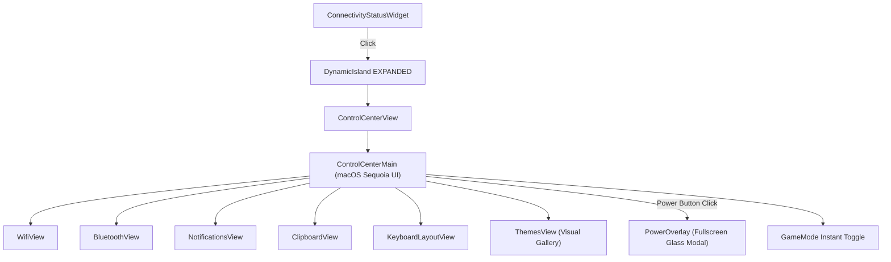

# Control Center UI Component Suite

> [!NOTE]
> `shell/components/widgets/controlcenter/` is a unified, Apple macOS/iOS inspired **Control Center** application running within the Dynamic Island in EXPANDED state mode.

---

## 1. Overview & Architecture

* **Design Inspiration:** Apple macOS Sequoia & iOS 18 minimalist control center. Zero emoji clutter, pure vector Nerd Font iconography, thick rounded capsule sliders, and grouped connectivity tiles.
* **Entry Point:** Clicking the right-slot `[[Connectivity-Status-Widget]]` pill during `HOVER` mode expands the island into `expandedActiveTab = "CONTROL_CENTER"`.
* **Sub-App Router (`ControlCenterView.qml`):**
  - Hosts `ControlCenterMain.qml` alongside dedicated sub-views.
  - **Auto-Reset to Main:** Ada kapandığında (`collapse()`), görünürlük değiştiğinde (`onVisibleChanged`) veya adadan bağlantı butonuna tıklandığında otomatik `resetToMain()` çağrılarak kullanıcının her zaman ana kontrol merkezi menüsünden (`MAIN`) başlaması garanti edilir.
  - Navigating into a sub-application dynamically adapts the island geometry via smooth spring animations.

---

## 2. Component Modules

1. **Shared Apple HIG Primitives (`views/`):**
   * **`CCViewHeader.qml`:** Tüm alt görünümlerde ortak kullanılan dairesel geri butonu (`󰅁`), `Style.fontDisplay` / `Style.fontText` başlık-alt başlık hiyerarşisi ve sağ aksiyon slotu.
   * **`CCSegmentedControl.qml`:** `[[Apple-HIG-Minimal-Design-System]]` standardına uygun, tek parçalı yarı saydam ray üzerinde `SpringAnimation` (`spring: 28.0`, `damping: 0.78`, `epsilon: 0.01`) ile kayan seçim kapsülü (`WifiView` ve `AudioMixerView`).

2. **`ControlCenterMain.qml`:**
   * **Row 1 - Split Connectivity & Toggles:**
     * Left Column: Grouped Apple-style frosted card (`Style.borderSubtle` hairline keylines) for **Wi-Fi / Kablolu Ağ** and **Bluetooth** with circular status badges, active device subtitle, and vector chevrons (`󰅂`).
     * Right Column: 2x2 squircle quick action grid (**Odak Modu**, **Bildirim** — okunmamış nokta göstergesi & sessizde vurgusu, **Tema** — aktif tema vurgu noktası + kısa adı, sağ tıkla sıradaki duvar kağıdı geçişi, **Pano**). Tüm aktif durumlar 7 temada (Monochrome dahil) yüksek kontrastlı yumuşak cam vurguları kullanır.
   * **Row 2 & 3 - Apple Capsule Sliders:**
     * **Ekran Parlaklığı (Brightness):** Thick, interactive rounded frosted capsule slider with embedded glyph (`󰃟`) and smooth width transitions.
     * **Ses Seviyesi (Volume) & Canlı Reaktif PipeWire Entegrasyonu:**
       - `Quickshell.Services.Pipewire` (`PwObjectTracker`) ile varsayılan ses çıkış cihazını (`Pipewire.defaultAudioSink`) anlık izler.
       - Harici klavye kısayollarından, ses düğmelerinden veya başka uygulamalardan (`pactl`, `wpctl`, `pavucontrol`) ses değiştirildiğinde veya sessize alındığında (`muted`), kontrol merkezi açıkken ses kapsülü ve yüzde göstergesi **0 milisaniye gecikme ile anlık ve reaktif** olarak güncellenir.
       - Sürükleme veya tıklamada doğrudan PipeWire nesnesi güncellenir, PipeWire bulunmayan ortamlarda (veya `%100` üzeri yükseltmede) otomatik `wpctl` (`-l 1.0`/`1.5`) yürütülür.
       - `Config.audioOverAmplification` aktifken kaydırıcı `%0–%150` ölçeğine genişler, `%100` noktasında dikey eşik çizgisi gösterir ve `%100` üzerini turuncu/kırmızı boost tonuyla vurgular. (`[[Configuration-System-Spec]]`, `[[Settings-Application-Component]]`)
   * **Row 4 - Status Footer:**
     * **Klavye Düzeni:** Clickable `[ 󰌌 TR ]` pill. Hem Go backend `switch_keyboard_layout` hem de `hyprctl switchxkblayout` fallback'i ile anında TR/US/DE/FR düzenleri arasında geçiş yapar.
     * **Minimalist Telemetri:** `CPU 12% · RAM 34% · GPU 0% · 1.2 MB/s` (Go `sys_metrics` stream'inden reaktif okur; sabitlendiğinde sade `󰐃` rozeti ile `[[Pinned-Metrics-Widget]]` ile senkronize çalışır).
     * **Ayarlar (`󰒓`) & Güç Butonu (`󰐥`):** Ayarlar uygulamasını veya tam ekran koyu cam blurlu `[[Power-Overlay-Component]]` menüsünü açar.

3. **Sub-Application Views (`views/`):**
   - **`ThemesView.qml` (Split Studio Görünüm & Adaptör Yöneticisi):**
     - Sol sütunda 7 temanın tamamını kaydırmasız sunan çift tonlu dairesel swatch (`bg` + `accent`) listesi; sağ sütunda normal dikey mouse tekerleği ile kaydırılabilen **2 sütunlu geniş duvar kağıdı galerisi** (aynı anda 6 önizleme, hover/aktif dosya adı scrim'i ve aktif `󰄬` rozeti).
     - Üst çubukta aktif temanın 5 renkli palet hapı, `󰒟 Sıradaki` duvar kağıdı geçiş butonu ve Go daemon'un `enabledThemeAdapters` (`Hyprland`, `Kitty`, `Zed`, `Vesktop`, `Neovim`, `GTK 3/4`, `Qt/Dolphin`, `Tmux`, `Starship`, `Btop`, `IntelliJ`, `Android Studio`) senkronizasyon anahtarlarını açıp kapatan `󰏖` çekmece görünümü.
   - **`WifiView.qml` (Ağ ve Bağlantı Yöneticisi):**
     - `CCSegmentedControl` ile kayan `[ 󰈀 Kablolu | 󰤨 Wi-Fi ]` sekme geçişi ve kenarlıksız tek parça liste yüzeyi.
     - **Kablolu (Ethernet) Yönetimi:** `nmcli` entegrasyonu ile fiziksel ethernet adaptörleri, IP/Geçit telemetrisi ve canlı Bağlan/Kes kontrolü.
     - **Kablosuz (Wi-Fi) Yönetimi:** Taranan Wi-Fi ağları, şifreli ağlar için kilit göstergesi (`󰌾`) ve satır içi parola girişi, dönen `󰑐` tarama animasyonu.
   - **`BluetoothView.qml`:** Saf monokrom Nerd Font cihaz ikonları (`󰋋`, `󰌌`, `󰍽`, `󰏲`, `󰂯`), Apple tarzı yay animasyonlu güç anahtarı ve dönen `󰑐` tarama butonu.
   - **`NotificationsView.qml`:** Sıfır emoji, uygulama bazlı vektör ikonlar, okunmamış bildirimler için minimal nokta göstergesi, DND kapsülü ve tek parça detay okuma sayfası.
   - **`ClipboardView.qml`:** Vektör sabitleme ikonları (`󰐃`/`󰐄`), sade liste satırları ve başlıkta hızlı kopyalama aksiyonlu tam metin önizleme sayfası.
   - **`KeyboardLayoutView.qml`:** `CCViewHeader` ile birleştirilmiş düzen listesi ve hızlı `󰑐 Sonraki` geçiş kapsülü.
   - **`AudioMixerView.qml` & `VolumeCapsuleSlider.qml`:** `CCSegmentedControl` sekme çubuğu, uygulama/çıkış aygıtı ses kapsülleri ve `%150` over-amplification desteği.
   - **`PowerOverlay.qml`:** Bağımsız tam ekran oturum ve güç katmanı (`[[Power-Overlay-Component]]`).

---

## 3. Related Links

* Connectivity Pill: `[[Connectivity-Status-Widget]]`
* Dynamic Island: `[[Dynamic-Island-Component]]`
* Power Overlay: `[[Power-Overlay-Component]]`
* Daemon IPC: `[[Daemon-IPC-Client]]`
* Theme Service: `[[Theme-Service]]`
