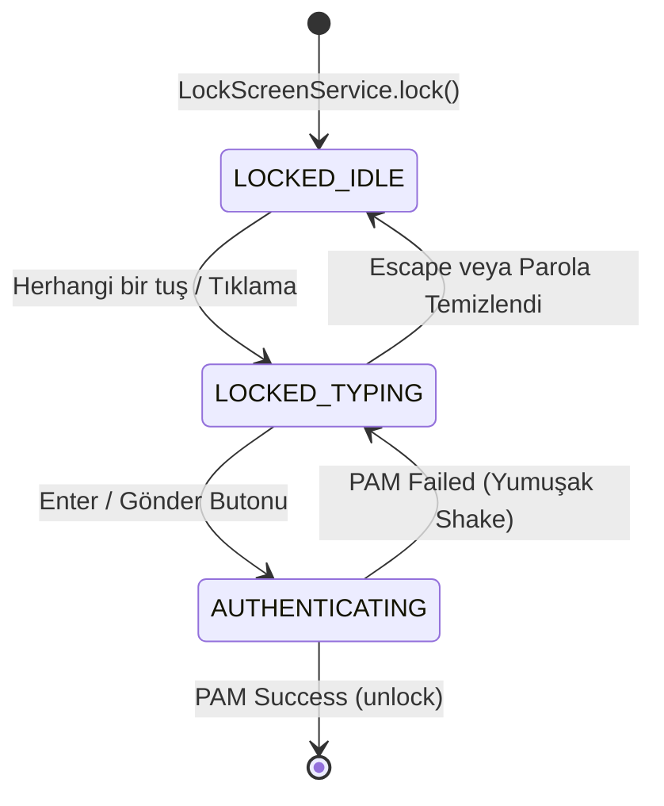

# Native Wayland Lock Screen Component

`ogsShell-qs` için `hyprlock` yerine geçen, Wayland `ext-session-lock-v1` (`WlSessionLock`) protokolü ve yerel Linux PAM (`Quickshell.Services.Pam.PamContext`) doğrulamasıyla çalışan sıfır gecikmeli kilit ekranı mimarisi.

> [!NOTE]
> Kilit ekranı `[[Shell-Root-PanelWindow]]` içine gömülü `WlSessionLock` üzerinden çalışır; kilitli değilken sıfır pencere/yüzey oluşturur (`0 MB` ek bellek), kilitlendiğinde ise tüm bağlı monitörleri eşzamanlı ve güvenli biçimde örter.

---

## 1. Dosya Konumları ve Bileşen Yapısı

* **Durum & PAM Servisi (Singleton):** `shell/backend/LockScreenService.qml` (`shell/qmldir` içinde `singleton LockScreenService 1.0`)
* **Ana Kilit Yüzeyi:** `shell/components/lockscreen/LockScreenSurface.qml`
* **Üst Notch / Island Parola Merkezi:** `shell/components/lockscreen/LockScreenAuthNotch.qml`
* **Kök Bağlantı:** `shell/shell.qml` (`WlSessionLock` + `WlSessionLockSurface`)
* **Tetikleyiciler:**
  * CLI: `ogsshell lock` (`scripts/ogsshell.sh` $\to$ `open_app {"app": "lock"}`)
  * Komut Paleti: `[[Bottom-Command-Notch]]` üzerinden `:lock` komutu

---

## 2. Canlı Bulanık Ekran Görüntüsü Arka Planı (Pre-Lock Capture Pipeline)

Kilit talebi (`LockScreenService.lock()`) geldiğinde `WlSessionLock.locked = true` yapılmadan hemen önce:

1. Açık olan geçici katmanlar (`PowerService`, `BottomNotchService`, `SnippingService`, `WindowInspectorService`) kapatılır.
2. Bağlı her monitör için paralel olarak `grim -l 0 -o <output> /tmp/ogs_lock_<output>.png` çalıştırılır (~40-80ms).
3. Yakalama tamamlandığında (veya en geç 800ms güvenlik zaman aşımında) `WlSessionLock.locked = true` tetiklenir.
4. `LockScreenSurface.qml` her monitörün kendi yakalanan karesini GPU hızlandırmalı `FastBlur` (`Config.lockscreenBlurRadius`) ve koyu karartma katmanı (`Config.lockscreenDimOpacity`) ile işler.
5. Kilit açıldığında (`unlock()`), gizlilik ve bellek temizliği amacıyla geçici `/tmp/ogs_lock_*.png` dosyaları silinir ve görüntü kaynakları boşaltılır.

---

## 3. Üst Notch / Island Morfoloji Durum Makinesi

Üst parola merkezi aktif `Config.formFactor` (`"notch"` veya `"island"`) değerine ve `[[Dynamic-Island-Component]]` yüksekliğine birebir uyum sağlar; tüm boyut ve giriş geçişlerinde yumuşak `Easing.OutQuart` / `Easing.OutCubic` (`300-360ms`) eğrilerini kullanır:



* **`LOCKED_IDLE`:** Yalnızca üzerinde kilit simgesi (`󰌾`) bulunan kompakt `#000000` saf OLED siyah çentik/ada (`96×28px`, aktif `notch.idle_height` / `island.idle_height` ile eşleşir). Görünmez odak hazır bekler; kullanıcının tıklamasına gerek kalmaz.
* **`LOCKED_TYPING`:** İlk karakter basıldığı anda tek satırlık sade bir giriş kapsülüne (`284×44px`) genişler. Gereksiz başlık/telemetri/iç kutu barındırmaz; doğrudan saf siyah çentik üzerinde kilit ikonu, **`*` karakterli kenarlıksız parola girişi** (`passwordCharacter: "*"`) ve minimalist gönder ikonu yer alır.
* **`AUTHENTICATING`:** `PamContext` (`config: "login"`) üzerinden asenkron doğrulama yapılır. Hatalı girişte yumuşak yatay sarsılma ve geçici kırmızı ikon vurgusu gösterilip parola alanı hızla yeniden yazmaya hazır hale gelir.

---

## 4. Konfigürasyon Şeması (`config.json` -> `lockscreen`)

```json
"lockscreen": {
  "blur_radius": 64,
  "dim_opacity": 0.46,
  "clock_font": "SF Pro Rounded",
  "clock_weight": "SemiBold",
  "date_font": "SF Pro Text",
  "clock_size": 196,
  "date_size": 18,
  "show_media": true,
  "show_power": true,
  "pam_config": "login"
}
```

---

## 5. İlgili Dokümantasyon ve Bağlantılar

* Kök Pencere Katmanı: `[[Shell-Root-PanelWindow]]`
* Dinamik Ada Bileşeni: `[[Dynamic-Island-Component]]`
* Dynamic Notch Tasarım Şartnamesi: `[[Dynamic-Notch-Design-Specification]]`
* Ters Alt Çentik: `[[Bottom-Command-Notch]]`
* Güç Menüsü: `[[Power-Overlay-Component]]`
* Keyring Güvenlik Modalı: `[[Keyring-Prompt-Modal]]`
* Konfigürasyon Sistemi: `[[Configuration-System-Spec]]`
* Tasarım Token'ları: `[[Style-Design-Tokens]]`
* IPC İstemcisi: `[[Daemon-IPC-Client]]`
