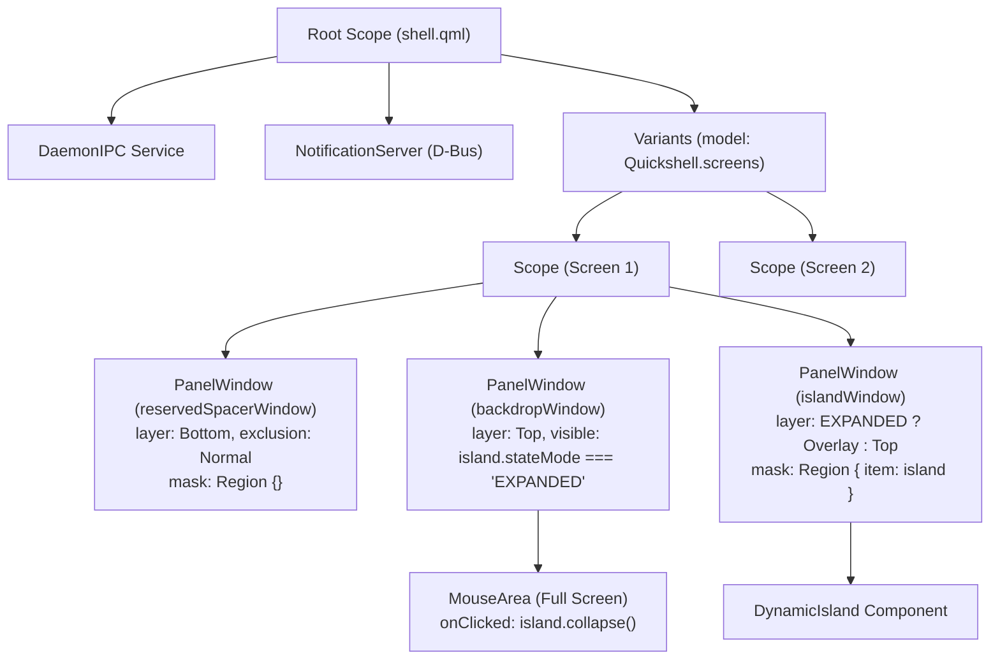

# Shell Root Scope & Multi-Window Architecture

> [!NOTE]
> `shell/shell.qml` utilizes Quickshell's `Scope` and `Variants` components to coordinate three distinct Wayland `PanelWindow` surfaces per connected monitor (`Quickshell.screens`): a reserved spacer window for automatic tiling clearance, a dynamically sized overlay canvas for the `DynamicIsland`, and a full-screen backdrop window that captures clicks outside the island when `EXPANDED`.

---

## 1. Window Structure & Layer-Shell Architecture

1. **`reservedSpacerWindow` (Görünmez Tiling Boşluk Katmanı):**
   * **Katman:** `WlrLayershell.layer: WlrLayer.Bottom`
   * **Exclusion Mode:** `ExclusionMode.Normal`
   * **Yükseklik:** `Config.isNotch ? Config.notch.idle_height : (Config.island.idle_height + Config.island.top_margin)`
   * **Girdi:** `mask: Region {}` (Boş maske sayesinde fare tıklamalarını kesinlikle engellemez, tamamen şeffaftır).
   * Hyprland/Wayland kompozitörüne adanın idle yüksekliği kadar boşluk rezerve ettirerek pencerelerin ada altına girmesini engeller.

2. **`backdropWindow` (Lazy Loaded Arka Plan Kapanış Katmanı):**
   * `LazyLoader` ile sarılıdır; yalnızca `stateMode === "EXPANDED"`, `topRightTrayHud.isExpanded` veya `BottomNotchService.isOpen` iken oluşturulur ve kapandığında GPU/EGL belleğini tamamen serbest bırakır.
   * **Katman:** `WlrLayershell.layer: WlrLayer.Top`, `ExclusionMode.Ignore`.

3. **`islandWindow` (Birleşik Üst Overlay Yüzeyi):**
   * **Tek EGL Yüzeyinde 4 Bileşen:** `[[Dynamic-Island-Component|DynamicIsland]]`, `[[Pinned-Metrics-Widget|PinnedMetricsWidget]]`, sol-üst `[[Corner-Island-HUD-Component|CornerIslandHUD]]` ve sağ-üst `[[Top-Right-Tray-HUD-Component|TopRightTrayHUD]]` (veya statik köşe) tek bir üst `PanelWindow` (`implicitHeight: 470`) içinde birleştirilmiştir. Bu yapı çift monitörlü NVIDIA EGL ortamında 4 ayrı OpenGL/EGL bağlamını (~55+ MB özel RAM) ortadan kaldırır.
   * **Dinamik Katman:** `island.stateMode === "EXPANDED"`, `topLeftCornerHud.isExpanded` veya `topRightTrayHud.isExpanded` durumlarında `WlrLayer.Overlay`; aksi halde `WlrLayer.Top` (tam ekran uygulamaların altına düşer).
   * **Tam Ekran Bileşen İzolasyonu (Fullscreen Component Isolation):**
     * Kök `Scope` içindeki global `Hyprland.onRawEvent` dinleyicisi, `fullscreen` / `fullscreenv2` socket2 olaylarında `Hyprland.refreshToplevels()` ve `Hyprland.refreshWorkspaces()` çağrısı yaparak tam ekran durumunu anlık senkronize eder.
     * Monitör başına `screenScope.hasFullscreenWindow`, aktif (veya aktif special) çalışma alanındaki pencerelerde yalnızca gerçek tam ekran modunu (`FSMODE_FULLSCREEN`, `fullscreen >= 2` veya `wayland.fullscreen === true`) algılar; `FSMODE_MAXIMIZED` (`1`) pencerelerde çentik görünür kalır.
     * Tam ekran aktifken `islandWindow`, örneğin ses değişiminde yalnızca `topLeftCornerHud.isExpanded` (veya `topRightTrayHud.isExpanded`) sebebiyle `WlrLayer.Overlay` katmanına çıktığında, genişletilmemiş kardeş bileşenler (`DynamicIsland` `hideIslandForFullscreen` ile, `PinnedMetricsWidget`, statik köşe kesimleri ve kapalı tepsi) `visible: false` tutularak tam ekran uygulamanın üzerinde belirmez ve ekstra EGL yüzeyi açılmadan 0 ek RAM maliyetiyle izole edilir.
     * Aynı durumda `activeInputEnvelope` ve `activeTrayInputEnvelope` boyutları `0×0` olarak daraltılır; böylece `Overlay` katmanındaki pencere tam ekran uygulamanın üst orta ve sağ üst tıklamalarını yutmaz.
   * **Exclusion Mode:** `ExclusionMode.Ignore` (Ada genişlediğinde pencereleri aşağı itip titretmez).
   * **Çoklu Bölge Girdi Maskesi (`mask: Region { Region { item: activeInputEnvelope }; Region { item: activeTrayInputEnvelope } }`):**
     * Sadece Dynamic Island (veya Focus Mode gizli hotspot) ve Sağ-Üst Tepsi HUD sınırları tıklama alır; üst şeridin geri kalanı ve sol-üst köşe HUD tamamen click-through çalışır.

4. **İsteğe Bağlı `LazyLoader` Overlay Yüzeyleri (Boşta 0 MB RAM):**
   * **`powerOverlayWindow`:** Yalnızca `PowerService.isPowerMenuOpen` iken yüklenir (`WlrLayer.Overlay`, `WlrKeyboardFocus.Exclusive`).
   * **`bottomNotchWindow`:** Yalnızca `BottomNotchService.isOpen && screenScope.isFocusedMonitor` iken ortalanmış kompakt `640×400` yüzey olarak yüklenir.
   * **`snippingOverlayWindow` & `inspectorOverlayWindow`:** Yalnızca `SnippingService.isOpen` veya `WindowInspectorService.isOpen` olduğunda yüklenip kapandığında bellekten düşer.

5. **`bottomCornersWindow` (İnce Alt Köşe Şeridi):**
   * Eski tam ekran `1920×1080` `screenCornersWindow` yerine yalnızca `radius` (`14px`) yüksekliğinde tek bir alt şerit penceresi (`LazyLoader`, `mask: Region {}`) ile hem sol-alt hem sağ-alt kavisli köşeleri çizer.

---

## 2. Multi-Monitor Capabilities

1. **Automatic Display Detection (`Quickshell.screens`):**
   * Using Quickshell's `Variants { model: Quickshell.screens }`, every connected monitor automatically spawns its own top overlay island, reserved spacer, and full-screen backdrop.
   * Hotplugging displays dynamically adds or cleans up island surfaces on Wayland without restarting the shell daemon.

2. **Decoupled Outside Click Backdrop:**
   * Each monitor's `backdropWindow` is a separate full-screen `PanelWindow` bound to `screen: screenScope.modelData`.
   * When `island.stateMode === "EXPANDED"`, clicking anywhere on that screen smoothly collapses that screen's island without affecting other monitors.

3. **Synchronized Global Events & Autonomous State:**
   * Alarms, Pomodoro milestones, and Freedesktop/D-Bus notifications broadcast via `DaemonIPC` trigger animations across all active display islands simultaneously.
   * Mouse hover and expanded app interactions remain independent per monitor.

4. **Monitöre Özel Bağımsız Odak Modu (Per-Monitor Focus Mode Autohide):**
   * Her ekran örneği (`screenScope`), `Hyprland.monitorFor(screenScope.modelData)` üzerinden kendi fiziksel monitörünün `activeWorkspace` nesnesini bağımsız olarak çözümler.
   * `hasTilingWindows` sorgusu sadece ilgili ekranın aktif çalışma alanındaki pencereleri denetler.
   * Bir monitörde tiling uygulama açıkken adası otomatik olarak yukarı gizlenir; uygulamanın olmadığı (boş masaüstü) monitörde ise ada görünmeye devam eder. Detaylar için: `[[Plan-Per-Monitor-Focus-Mode-Autohide]]`.
