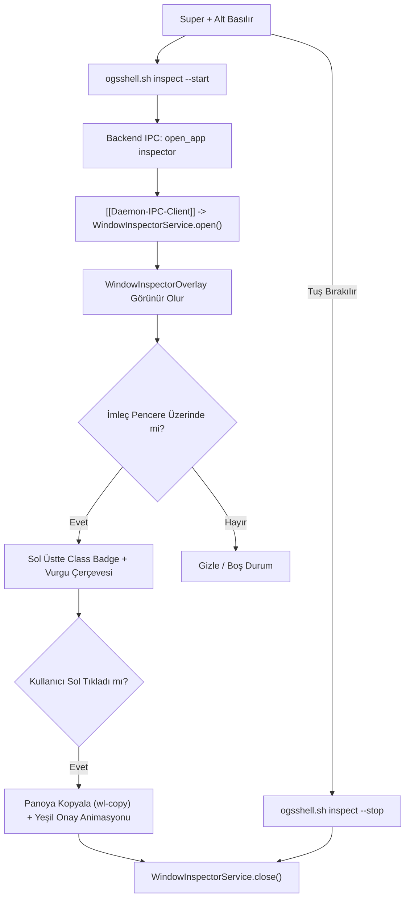

# Window Inspector Overlay Bileşeni

`WindowInspectorOverlay.qml`, kullanıcının `Super + Alt` donanım kısayoluna basılı tutarken (Hold) veya aç/kapat (Toggle) modunda imleçle üzerine geldiği pencerenin **yalnızca `class` (app_id)** bilgisini pencerenin sol üst köşesinde minimal bir kapsül rozet (Badge) içinde görüntüleyen ve tıklandığında bu değeri panoya kopyalayan tam ekran Wayland LayerShell arayüz bileşenidir.

---

## 1. Mimari Genel Bakış ve Çalışma Prensibi

Bileşen, [[Shell-Root-PanelWindow]] kök koordinatörünün her monitör için ürettiği `Variants` kapsamında bir `PanelWindow` olarak barındırılır.

* **LayerShell Katmanı:** `WlrLayershell.layer: WlrLayer.Overlay`
* **Klavye Odağı:** `WlrLayershell.keyboardFocus: WlrKeyboardFocus.None` (Klavye odağını çalmaz; bu sayede Hyprland `bindr` tuş bırakma olaylarını kesintisiz algılar).
* **Ekran Dışlama Modu:** `exclusionMode: ExclusionMode.Ignore` (Pencereleri itmez, ekranın üzerinde süzülen şeffaf bir katmandır).
* **Hızlı Pencere Tespiti:** İmleç koordinatları (`localX, localY`) monitör global ofsetiyle toplanarak `Quickshell.Hyprland` modülünün sağladığı `Hyprland.toplevels.values` listesinde ters sırada (en üstteki pencereler önce gelecek şekilde) taranır.



---

## 2. Arayüz ve Tasarım Detayları

Bileşen, [[Style-Design-Tokens]] ve Apple HIG ilkelerine tam uyumlu olarak tasarlanmıştır:

1. **Vurgu Çerçevesi (Outline Highlight):**
   * Pencere sınırlarını çevreleyen son derece hafif ve yumuşak 1.5px Catppuccin Sapphire (`rgba(137, 180, 250, 0.40)`) kenarlık ve `%2` opaklıkta derinlik tonu.
   * Tıklama anında yumuşak yeşil (`#a6e3a1`) renk geçişi.
2. **Apple HIG Kapsül Rozet (Floating Capsule Pill):**
   * Pencerenin üst kenarının hemen üzerinde (`localY - badgeHeight - 8px`) süzülür. Pencere ekran tavanına yapışıksa ekran dışına taşmaması için akıllı fallback ile pencerenin üst sınırına yerleşir (`radius: height * 0.5` ile tam hap/kapsül formu).
   * Monitör kenarlarından taşmaması için dinamik sınır koruması (`Math.max` / `Math.min`).
   * Zemin: `#0d0f17` (OLED Derin Siyah) ile `1px solid rgba(255, 255, 255, 0.18)` ince vurgu kenarlığı.
   * Derinlik: `RectangularGlow` ile yumuşak ortam gölgesi (`glowRadius: 10`, `spread: 0.18`).
   * **İçerik Elemanları:**
     - Parlayan durum noktası (Normalde `#89b4fa`, kopyalandığında `#a6e3a1`).
     - Yüksek okunabilirlikli sınıf adı (`Noto Sans Display` / `Plus Jakarta Sans`, 11px DemiBold, `letterSpacing: 0.35`).
     - Mini kopyalama göstergesi (`📋`).
   * **Fizik:** Pencereler arasında geçiş yaparken ve ilk açılışta `SpringAnimation` (`spring: 28.0`, `damping: 0.78`, `epsilon: 0.01`).
3. **Pano Geri Bildirimi:**
   * Tıklama yapıldığında `✓ Kopyalandı: <class>` metni belirir, zemin koyu zümrüt yeşiline (`#183226`) ve nokta ile metin canlı yeşile (`#a6e3a1`) döner.
   * 220ms sonra otomatik olarak kapanır.

> [!NOTE]
> [[Snipping-Overlay-Component]] ile benzer `Hyprland.toplevels` algoritması kullanılmasına rağmen, Window Inspector ekranı dondurmaz (freeze almaz); çalışan canlı pencereler üzerinde 0ms gecikmeli dinamik imleç takibi yapar.

---

## 3. IPC ve Tetikleme Entegrasyonu

Bileşen, hem tek seferlik aç/kapa (toggle) hem de basılı tutma (hold & release) yaşam döngülerini destekler:

| Komut | IPC Eylemi | Tetiklenen Servis Metodu |
| :--- | :--- | :--- |
| `ogsshell.sh inspect --start` | `open_app {"app":"inspector"}` | `WindowInspectorService.open()` |
| `ogsshell.sh inspect --stop` | `close_app {"app":"inspector"}` | `WindowInspectorService.close()` |
| `ogsshell.sh inspect --toggle` | `toggle_app {"app":"inspector"}` | `WindowInspectorService.toggle()` |

### Hyprland Yapılandırma Örneği

Kullanıcının `hyprland.conf` dosyasına ekleyebileceği önerilen tanımlama:

```ini
# Hold & Release (Super+Alt basılıyken göster, bırakınca kapat)
bind = SUPER, Alt_L, exec, ~/.config/ogsShell/ogsshell.sh inspect --start
bindr = SUPER, Alt_L, exec, ~/.config/ogsShell/ogsshell.sh inspect --stop

# Alternatif Toggle Kısayolu
bind = SUPER_ALT, I, exec, ~/.config/ogsShell/ogsshell.sh inspect --toggle
```

---

## 4. İlgili Bağlantılar ve Kaynaklar

* [[System-Architecture]]
* [[Shell-Root-PanelWindow]]
* [[Daemon-IPC-Client]]
* [[Snipping-Overlay-Component]]
* [[Style-Design-Tokens]]
